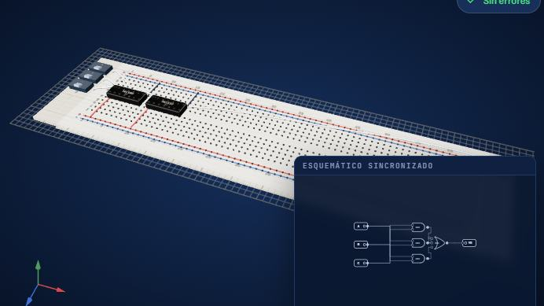
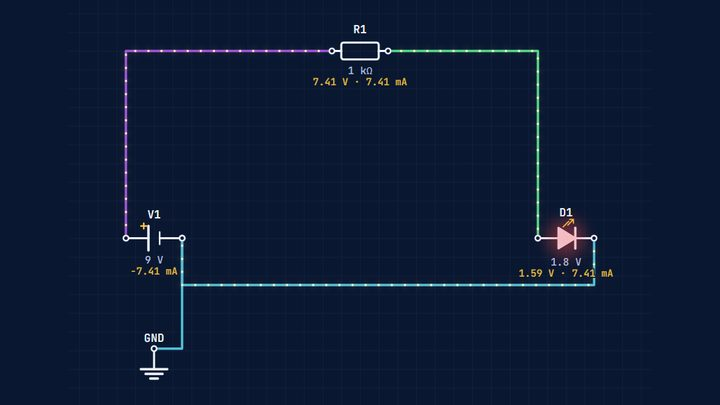
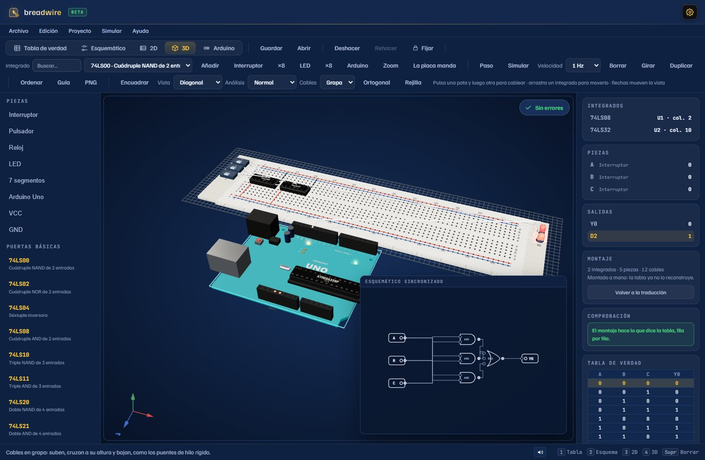
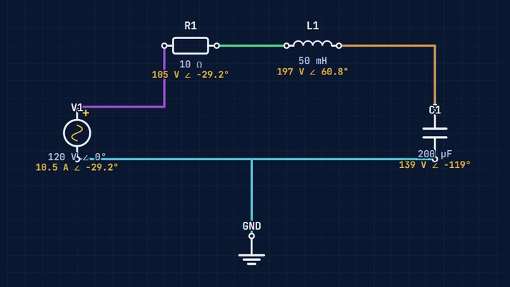

# breadwire

Breadwire is an open-source, browser-based electronics workbench designed to bridge the gap between schematic design and physical breadboarding. It features automated 2D/3D topological routing, a digital logic environment, and AC/DC circuit analysis. Our mission is to democratize hardware education by providing free licenses to public universities and schools in developing regions.

**Del esquema a la protoboard, hueco por hueco.** breadwire es un banco de
electrónica que funciona en el navegador: dibujas un esquema y te dice dónde va
cada pata y cada cable en una protoboard de verdad, en 2D y en 3D, comprobado
red por red. Además trae un entorno de electrónica digital con Arduino, un
simulador analógico y un entorno de análisis de circuitos.

- **Sitio**: <https://breadwire-beta.vercel.app>
- **Versión**: `1.0.0-beta.5` (beta: funciona y está verificada, pero puede
  tener errores). Los cambios de cada versión están en [`CHANGELOG.md`](CHANGELOG.md).
- **Idiomas**: español (el idioma fuente), inglés y japonés.
- **Sin cuenta y sin servidor**: todo se guarda en el navegador. La cuenta con
  Google, los proyectos en la nube y el asistente son opcionales.

## Los cuatro entornos

| Entorno | Página | Qué hace |
| --- | --- | --- |
| **Taller y montaje** (Traductor) | `index.html` → `protoboard.html` → `protoboard3d.html` | Esquema dibujado a mano → montaje en protoboard 2D y 3D, con guía paso a paso, revisión eléctrica (ERC), lista de materiales y exportación a SPICE, KiCad y Wokwi |
| **Sistemas digitales** | `digital.html` | Tabla de verdad o expresión → simplificación (Quine–McCluskey) → compuertas → 119 integrados 74xx en la placa. Arduino Uno, ESP32 y Pico con IDE, Blockly, depurador y siete piezas (servo, HC-SR04, potenciómetro, LDR, DHT11, LCD I²C y tira WS2812) |
| **Laboratorio de electrónica** (Simulador) | `simulador.html` | Continua y transitorio, osciloscopio de dos canales, generador de funciones y polímetro |
| **Circuitos eléctricos** (Análisis) | `circuitos.html` | CC y CA con fasores, potencia compleja, Thévenin y diagrama de Bode |

Las demás páginas: `login.html` (la puerta), `home.html` (la portada),
`projects.html` (mis proyectos), `privacidad.html` y `condiciones.html`.
`start.html` sólo redirige.

| | |
| --- | --- |
|  |  |
|  |  |

